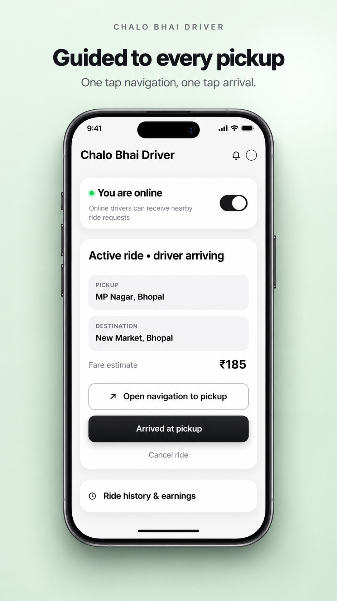
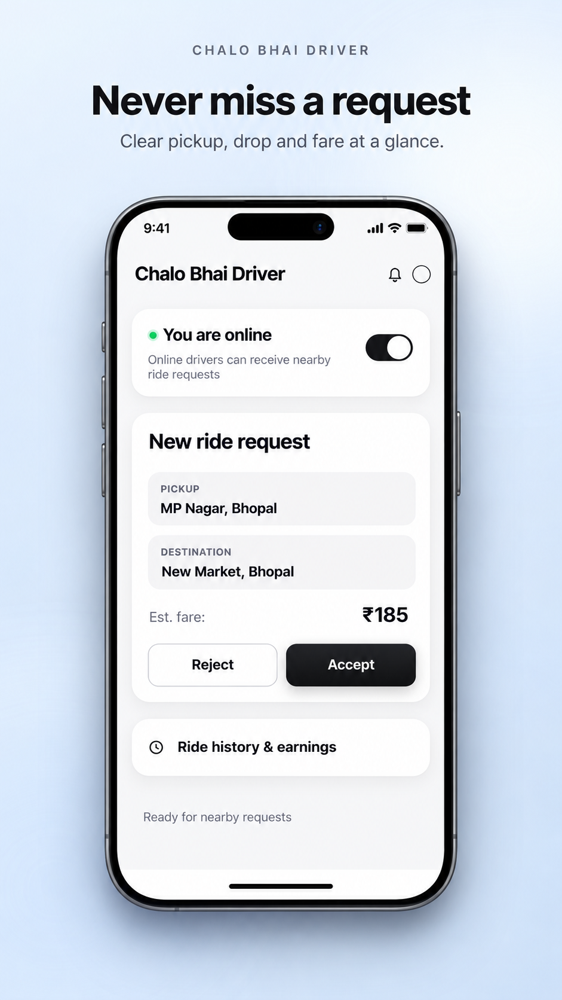
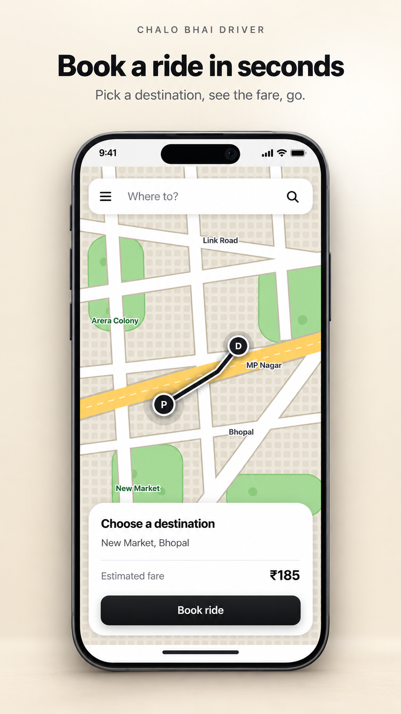
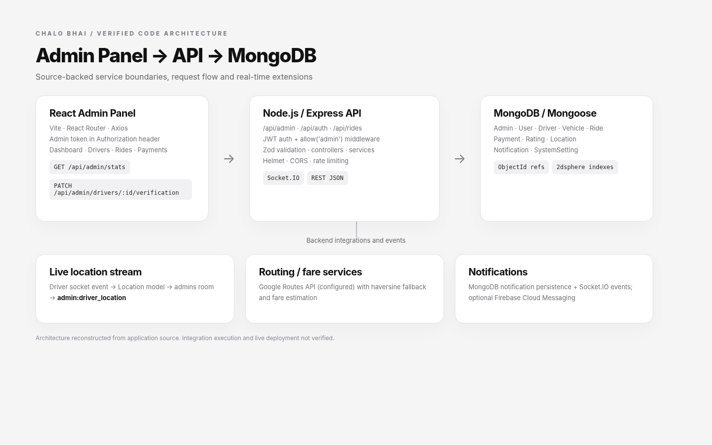
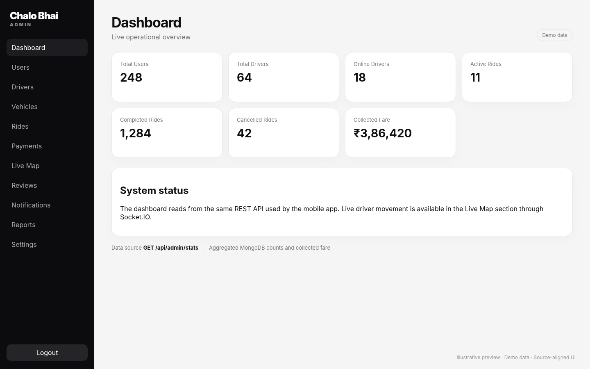
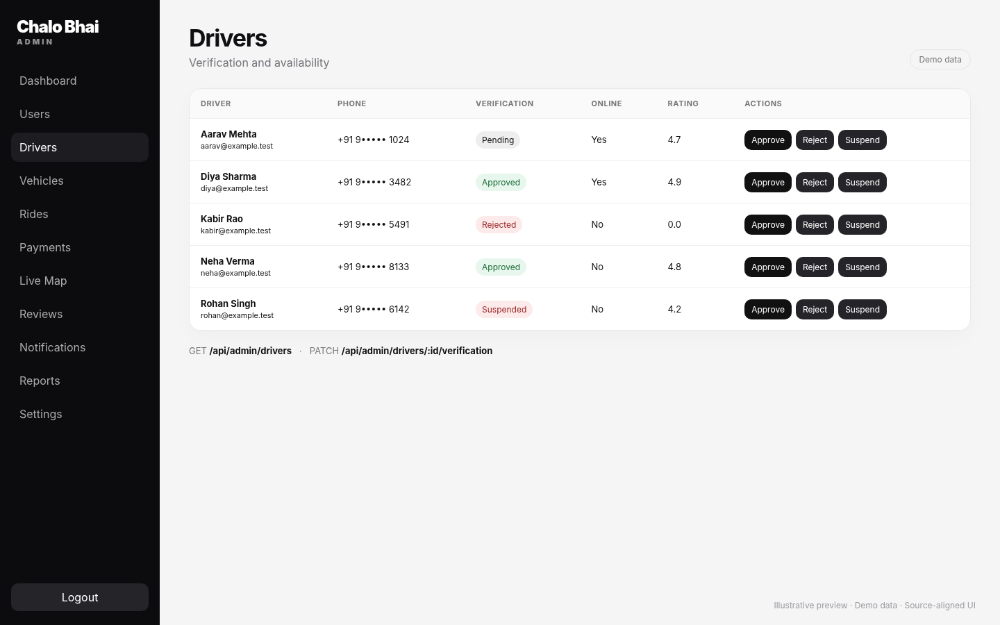
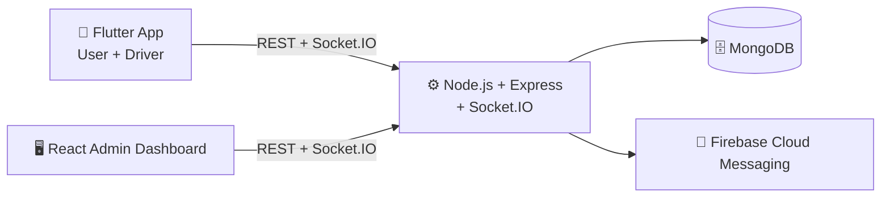
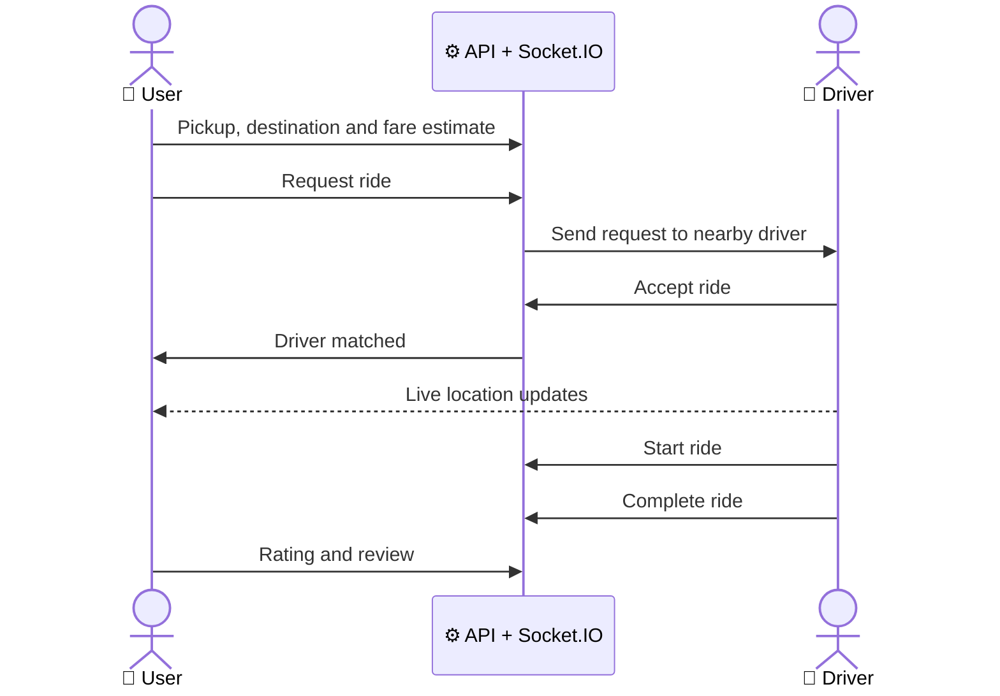

<div align="center">


<a href="https://git.io/typing-svg">

</a>

<br/>


<br/><br/>

**[Overview](#-overview) · [Screenshots](#-screenshots) · [Features](#-features) · [Architecture](#-architecture) · [Getting Started](#-getting-started) · [Roadmap](#-roadmap) · [Author](#-author)**

</div>

---

## 🚕 Overview

> *Ek tap, ek ride. Chalo Bhai connects riders and drivers in real time, with a full admin dashboard behind it.*

**Chalo Bhai** is a complete ride-hailing platform concept built as a connected ecosystem rather than a standalone UI. It has dedicated experiences for three kinds of people:

| | Who | What they do |
|:-:|---|---|
| 👤 | **Users** | Book rides, track drivers live, manage trips and ratings |
| 🚗 | **Drivers** | Go online, receive ride requests, manage trips and share live location |
| 🖥️ | **Admin** | Manage users, drivers, vehicles, rides and platform operations |

---

## 🖼️ Screenshots

### 📱 Mobile Application

<div align="center">





<p><em>The Chalo Bhai mobile experience</em></p>

</div>

### 🖥️ Admin Dashboard

<div align="center">



<p><em>📊 Dashboard Overview</em></p>



<p><em>🗂️ Management Interface</em></p>



<p><em>⚡ Additional Interface</em></p>

</div>

---

## ✨ Features

<details open>
<summary><b>👤 User App (for riders)</b></summary>
<br/>

| | Feature | Description |
|:-:|---|---|
| 🚕 | **Ride Booking** | Request a ride in a few taps |
| 📍 | **Pickup & Destination** | Choose where to start and where to go |
| 💰 | **Fare Estimation** | See the estimated fare before booking |
| 🤝 | **Driver Matching** | Get matched with a nearby driver |
| 🛰️ | **Live Ride Tracking** | Watch the driver arrive in real time |
| 🔄 | **Ride Status** | Follow every stage of the trip |
| 🕘 | **Ride History** | Look back at past trips |
| ⭐ | **Ratings & Reviews** | Rate drivers after each ride |
| 🔔 | **Notifications** | Stay updated with push notifications |

</details>

<details open>
<summary><b>🚗 Driver App</b></summary>
<br/>

| | Feature | Description |
|:-:|---|---|
| 🔐 | **Authentication** | Secure driver sign-in |
| 🟢 | **Online / Offline Mode** | Go online only when ready to drive |
| 📡 | **Live GPS Location** | Share location in real time |
| 📥 | **Ride Requests** | Receive incoming requests |
| ✅ | **Ride Acceptance** | Accept the rides you want |
| 🛣️ | **Active Ride Management** | Manage the current trip |
| 🧭 | **Navigation** | Get directions to pickup and drop |
| 🕘 | **Ride History** | Review completed trips |
| 💵 | **Earnings** | Track what you earn |

</details>

<details open>
<summary><b>🖥️ Admin Dashboard (for operators)</b></summary>
<br/>

- 📊 Dashboard and analytics
- 👥 User management
- 🚗 Driver management and approval
- 🚙 Vehicle management
- 🧾 Ride management
- 🗺️ Live driver map
- 💳 Payments
- ⭐ Ratings and reviews
- 🔔 Notifications
- 📈 Reports
- ⚙️ System settings

</details>

---

## 🧰 Tech Stack

<div align="center">

| Layer | Technologies |
|:-:|:--|
| **📱 Mobile** |    |
| **⚙️ Backend** |   |
| **🗄️ Database** |   |
| **🔄 Real-Time** |  |
| **🖥️ Admin** |   |
| **🔐 Auth** |   |
| **🗺️ Maps & Location** |   |
| **🔔 Notifications** |  |
| **🐳 DevOps** |   |

</div>

---

## 🏗️ Architecture



### 🔄 Core Ride Flow



---

## 📂 Project Structure

```text
chalo-bhai-ride-hailing-full-stack/
│
├── mobile/                  # Flutter application (User + Driver)
├── backend/                 # Node.js + Express API
├── admin/                   # React admin dashboard
│
├── screenshots/
│   ├── phone/               # mobile screenshots
│   └── admin/               # admin dashboard screenshots
│
├── docs/                    # Project documentation
├── docker-compose.yml       # Docker configuration
├── README.md
├── VALIDATION.md
└── BRANDING_CHANGES.md
```

---

## 🚀 Getting Started

### Prerequisites

- Flutter SDK and Dart
- Node.js (LTS) and npm
- MongoDB (local or Atlas), or Docker
- Google Maps API key and a Firebase project

### 1️⃣ Clone the repository

```bash
git clone https://github.com/keshavappdev/chalo-bhai-ride-hailing-full-stack.git
cd chalo-bhai-ride-hailing-full-stack
```

### 2️⃣ Run the backend

```bash
cd backend
npm install
npm run dev
```

### 3️⃣ Run the admin dashboard

```bash
cd admin
npm install
npm run dev
```

### 4️⃣ Run the mobile app

```bash
cd mobile
flutter pub get
flutter run
```

### 🐳 Or start everything with Docker

```bash
docker compose up --build
```

> Environment files and private credentials are intentionally excluded from the repository. Copy each `.env.example` to `.env` and fill in your own values.

---

## 🔐 Security

- 🚫 Keep API keys, database credentials, JWT secrets and service-account files **out of version control**.
- 🔑 Use **environment variables** for all sensitive configuration.
- 🛡️ Protect admin and driver endpoints with **server-side authorization**.
- ⚠️ Never publish real production credentials in the repository.

---

## 🎯 What This Project Demonstrates

- Cross-platform Flutter development
- REST API architecture
- Real-time communication with Socket.IO
- GPS and location-based services
- MongoDB data modeling
- Authentication and authorization
- React admin dashboard development
- Mobile ↔ Backend integration
- Docker-based development
- Full-stack application architecture

---

## 🗺️ Roadmap

- [x] User and driver authentication
- [x] Ride booking, driver matching and live tracking
- [x] Ratings and ride history
- [x] Admin dashboard
- [ ] In-app chat between rider and driver
- [ ] Surge pricing and promo codes
- [ ] Automated tests and CI/CD pipeline

---

## 🤝 Contributing

Ideas and improvements are welcome.

1. Fork the project
2. Create a feature branch: `git checkout -b feature/amazing-idea`
3. Commit your changes: `git commit -m "Add amazing idea"`
4. Push the branch: `git push origin feature/amazing-idea`
5. Open a Pull Request

---

## 👨‍💻 Author

<div align="center">

### Keshav Upadhyay

**Flutter / Mobile Application Developer**

<a href="https://github.com/keshavappdev">

</a>

<br/><br/>

⭐ **If you like this project, give it a star.** ⭐

</div>

